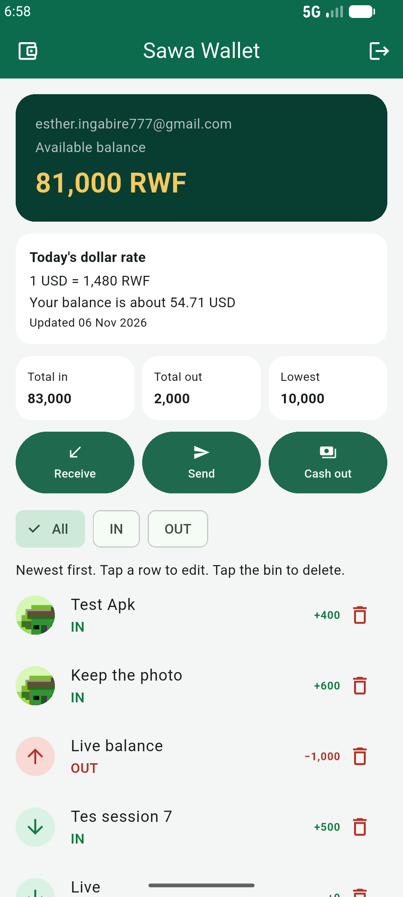
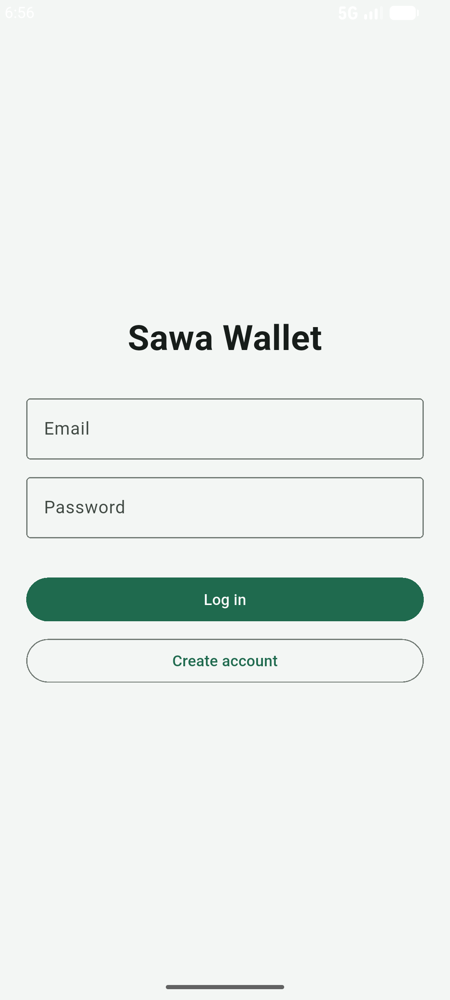
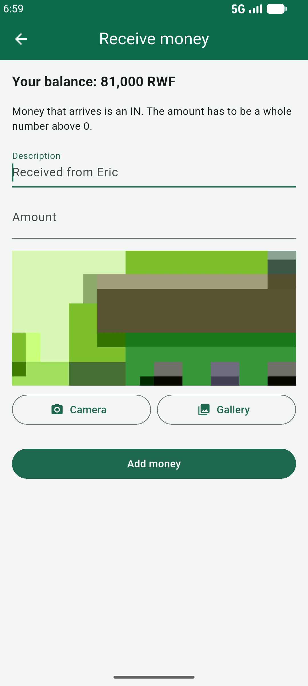

# Sawa Wallet

Ingabire Esther · 27202 · Group B

Track the money you send and receive, with a photo of every receipt,
on any phone you log in from.

Sawa Wallet signs you in with Firebase Authentication, and each user's data
is saved in Cloud Firestore under their own id, so two accounts never see
each other's data, and every change appears live.

## Download
[Download the latest APK](https://github.com/Esther-ingabire/momo_wallet/releases/latest)
(for Android phones)

## Features
- Create an account and log in
- Receive, send, and cash out, with a receipt photo
- Your balance, always up to date, on every phone, live
- Filter: all, money in, money out
- Your data is private: nobody else can read it

## Screenshots
| Login | Wallet | New transaction |
|---|---|---|
|  |  |  |

## How it's built
- Flutter, with Provider for state management
- Firebase Authentication and Cloud Firestore; photos on Cloudinary
- Four layers: models, repositories, state, screens

## Run it yourself
1. Clone the repository and run `flutter pub get`.
2. Connect your own Firebase project (`google-services.json`).
3. Put your Cloudinary cloud name and upload preset in
   `lib/repositories/photo_repository.dart`.
4. `flutter run`

## Author
Ingabire Esther: [GitHub](https://github.com/Esther-ingabire)