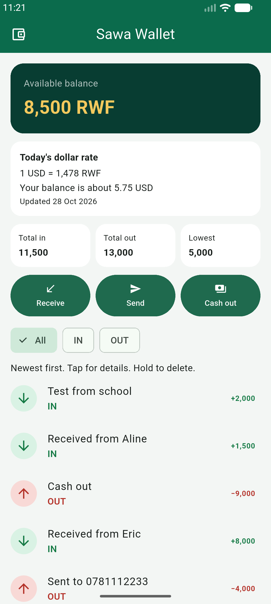
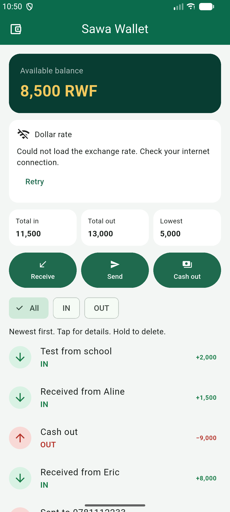

# Sawa Wallet

A MoMo-style wallet for receiving money, sending it, and cashing out. My data is now saved on the phone with shared_preferences, so nothing is lost when the app closes, and it shows today's US dollar rate in RWF from the ExchangeRate API at open.er-api.com.

## Screenshots

