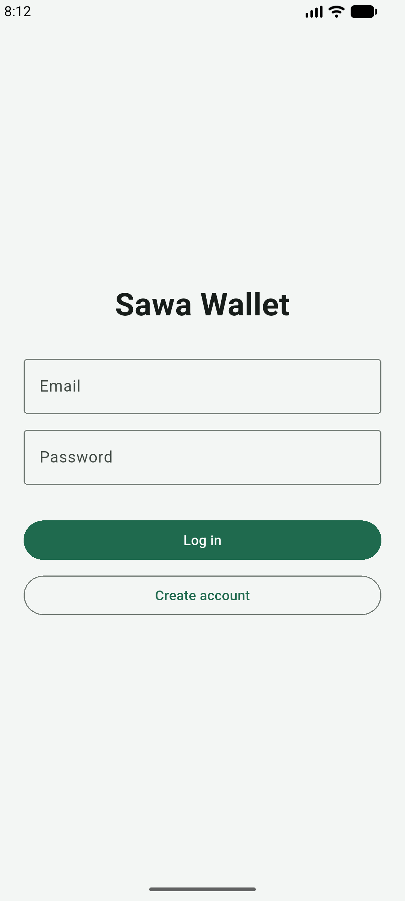
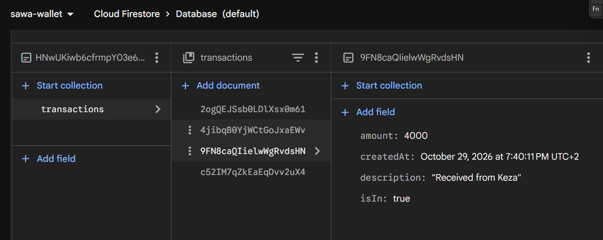
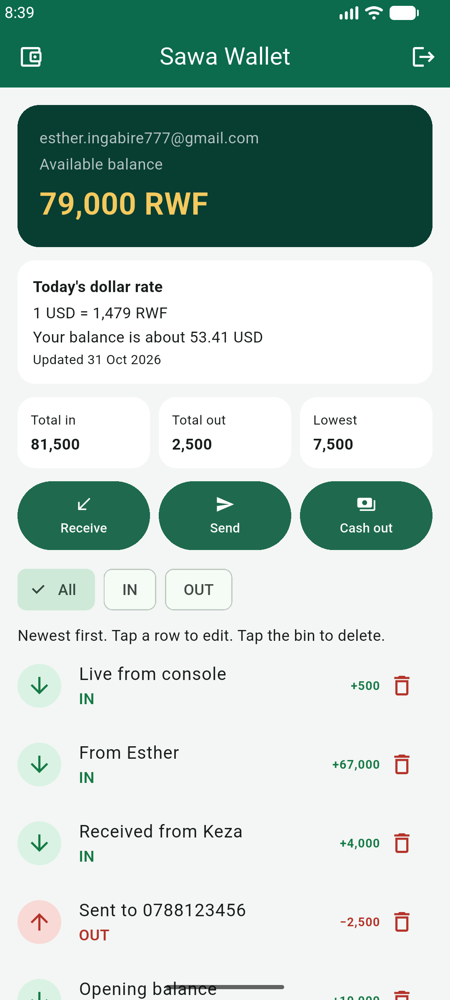
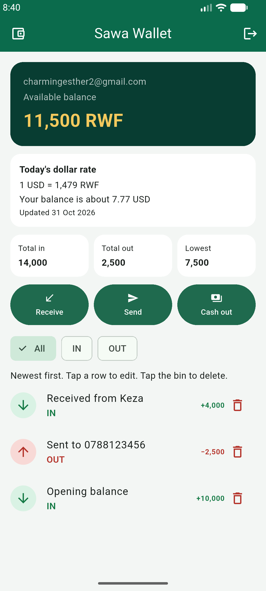

# Sawa Wallet

Ingabire Esther · 27202 · Group B

Sawa Wallet is a mobile-money app for receiving, sending, and cashing out. It signs users in with Firebase Authentication, and each user's data is saved in Cloud Firestore under their own id, so two accounts never see each other's data, and every change appears live.

## Screenshots

